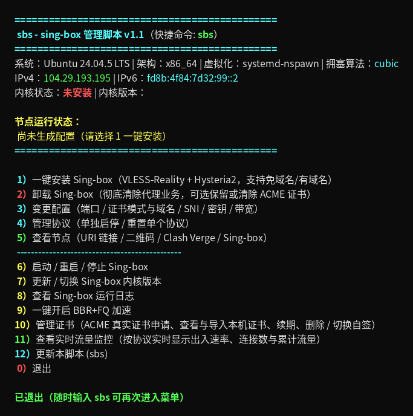

# sbs - 极简、纯净的 Sing-box 一键部署与管理脚本


**`sbs`** 是一个专为追求**纯净、透明、可控**的用户设计的 `sing-box` 一键部署与运维管理脚本。它专注于目前最主流、抗封锁能力最强的 **VLESS-Reality** 与 **Hysteria2** 双协议组合，剔除一切不必要的第三方组件，所有核心程序与证书均直接从官方源获取。

> **版本：v1.1**（`sbs --version` 显示的版本号）。
>
> v1.1 修复：换密钥 / 重置协议 / 更新内核 / 切换证书 / 强制续期等 11 处“重启失败却报成功”的问题，失败时红字报错加 `journalctl` 提示，不再打绿字、不再显示节点；免域名 HY2 链接现分 Xray 专用（`insecure=0 + pinSHA256`）与官方客户端专用（`insecure=1 + pinSHA256`）两条。

## 🚀 一键部署

在全新 Debian 12 / Ubuntu 22.04 / 24.04 的 VPS 上以 `root` 运行（推荐方式，先下载到本地再运行，之后可直接用 `sbs` 命令呼出菜单）：

```bash
curl -fsSL -o /root/sbs.sh https://raw.githubusercontent.com/jason-vr3/sbs/main/sbs.sh && chmod +x /root/sbs.sh && bash /root/sbs.sh
```

首次运行后，脚本会自动将自身注册为系统快捷命令。之后任何时候只需在终端输入：

```bash
sbs
```

即可直接呼出交互式管理菜单。

<details>
<summary>也可以用管道方式运行（不推荐）</summary>

```bash
bash <(curl -fsSL https://raw.githubusercontent.com/jason-vr3/sbs/main/sbs.sh)
```

管道方式可以正常打开菜单并安装，但**无法注册 `sbs` 快捷命令**（管道传入的是临时流，没有实体文件可复制），下次仍需重新下载或用管道方式运行。如需 `sbs` 命令，请用上面推荐的下载方式。
</details>

### 安装时会问什么

选 `1` 一键安装后，脚本会交互式询问（直接回车即使用默认值）：

| 询问项 | 默认值 | 说明 |
| --- | --- | --- |
| VLESS-Reality 端口（TCP） | `443` | |
| Hysteria2 端口（UDP） | `8443` | 注意：部分线路会拦截 UDP 443，实测 8443 可通，见 FAQ |
| Hysteria2 域名 | 留空 = 免域名自签模式 | 填域名则走 ACME 真实证书模式 |
| Reality SNI 伪装站 | `www.icloud.com` | |
| Hysteria2 上 / 下行带宽 | `100 / 100 Mbps` | |

装完后菜单 `5` 会打印两个节点的分享链接，密钥记录保存在 `/root/sbs-keys.txt`（权限 600）。

## 🖥️ 主界面



*上图为在测试机上运行 `bash sbs.sh` 的实拍主界面（IP 为测试机地址，状态为未安装；菜单 1–12 与下方表格一致）。*

## ✨ 核心特点与设计理念

1. **100% 官方纯净来源，拒绝黑盒**
   * **内核安装**：仅调用 `sing-box` 官方安装脚本（`https://sing-box.app/install.sh`）。
   * **证书申请**：仅调用 `acme.sh` 官方安装脚本（`https://get.acme.sh`）。
   * **精简配置**：不捆绑 Argo、WARP、Telegram 机器人或任何未知第三方二进制文件，全量配置收敛于单一标准的 `/etc/sing-box/config.json`。配置备份统一放在 `/root/` 下，绝不放进 `/etc/sing-box/`（该目录会被 sing-box 按目录模式加载全部 `.json`）。

2. **Hysteria2 有域名 / 免域名双模式**
   * **免域名模式（开箱即用）**：没有域名也能直接部署！自动生成高强度 EC 自签证书并计算 **SHA256 证书指纹（`pinSHA256`，64 位裸 hex）**。生成的链接形如 `insecure=0&allowInsecure=0&pinSHA256=...`，这是给 **Xray 内核客户端（v2rayN V7.20+ / NekoBox 等）**用的——Xray 26.3.27+ 已移除 `allowInsecure`，必须用指纹校验代替。**官方 Hysteria2 客户端则不同**：它需要在配置里同时设 `insecure: true` + `pinSHA256`，直接导入上方链接会先被证书链校验拦住；遇到这种情况请把链接里的 `insecure` 改为 `1` 再导入，或在客户端配置里设 `insecure: true` + `pinSHA256`。两种客户端不要混用同一条链接的预期。
   * **有域名模式（ACME 真实证书）**：支持自动向 Let's Encrypt 申请并续期真实 TLS 证书；支持自动扫描并一键导入本机已有的 ACME 或自定义目录证书，避免重复签发。

3. **全格式客户端配置导出与终端二维码**
   * 内置多格式导出中心，支持一键输出：
     * 标准 **URI 分享链接**（VLESS & Hysteria2）
     * **终端 UTF-8 二维码**（基于 `qrencode`，手机端 v2rayNG / Shadowrocket / NekoBox / sing-box 直接扫码）
     * **Clash Verge (Mihomo)** 节点与策略组 YAML 配置片段（自动保存至 `/root/sbs-clash.yaml`）
     * **Sing-box 客户端** `outbounds` JSON 配置片段（自动保存至 `/root/sbs-client-outbounds.json`）

4. **按协议独立的实时流量与连接监控**
   * 基于非侵入式 `iptables` / `ip6tables` 端口计数链与 `ss` 套接字状态，每秒实时刷新展示 **VLESS-Reality (TCP)** 与 **Hysteria2 (UDP)** 各自的实时上下行速率、当前活跃连接数及累计流量统计。

5. **贴心的运维与生命周期闭环**
   * **快捷指令**：首次运行自动注册 `sbs` 全局命令，随时输入 `sbs` 呼出菜单；支持独立启停单个协议而不丢失历史密钥与带宽配置。
   * **安全备份与彻底卸载**：每次修改配置前自动将旧配置备份至 `/root/`；每次写配置都先经 `sing-box check` 校验，失败自动回滚；卸载时支持自主选择是否保留 ACME 证书及历史密钥，选择清除后自动注销 `sbs` 命令并干净退出。
   * **BBR+FQ**：菜单 `9` 一键开启（先 `modprobe tcp_bbr` 再写 sysctl，重启后仍生效）。注意：BBR 只加速 VLESS 的 TCP，Hysteria2 走 QUIC 自有拥塞控制，不受内核 BBR 影响。

---

## 💻 支持系统与架构

* **操作系统**：Debian 12 / Ubuntu 22.04 / Ubuntu 24.04（脚本头声明；实测在 Ubuntu 24.04 上验证通过）
* **硬件架构**：`x86_64 (amd64)` / `aarch64 (arm64)`
* **权限要求**：需以 `root` 用户运行

---

## ⌨️ 命令行快捷参数

除了交互式菜单外，`sbs` 还支持直接通过命令行参数快速调用常用功能：

```bash
sbs                 # 进入交互式管理菜单
sbs --nodes         # 直接打印当前节点 URI 分享链接
sbs --qr            # 直接在终端输出节点二维码
sbs --clash         # 生成并查看 Clash Verge (Mihomo) YAML 配置片段
sbs --sb-client     # 生成并查看 Sing-box 客户端 outbounds JSON 配置片段
sbs --traffic       # 直接进入各协议实时流量监控面板
sbs --version       # 查看当前脚本版本
```

---

## 📋 管理菜单功能一览

| 菜单编号 | 功能名称 | 说明 |
| :---: | :--- | :--- |
| **1** | **一键安装 Sing-box** | 交互式引导完成依赖安装、内核部署、证书配置与双协议启动 |
| **2** | **卸载 Sing-box** | 彻底停止服务并清理代理业务，可选保留或删除 ACME 证书与密钥备份 |
| **3** | **变更配置** | 单独修改 VLESS/HY2 端口、切换免域名/有域名模式、修改 SNI、重置密钥或带宽 |
| **4** | **管理协议** | 单独启用或停用 VLESS / Hysteria2（保留原参数），或全新重置单个协议 |
| **5** | **查看节点** | 查看 URI 链接、终端扫码二维码、导出 Clash Verge 与 Sing-box 客户端片段 |
| **6** | **服务控制** | 启动、重启、停止 `sing-box` 服务并查看运行状态 |
| **7** | **更新 / 切换内核** | 通过官方脚本更新至最新正式版，或指定版本号切换并支持校验失败自动回滚 |
| **8** | **查看运行日志** | 支持实时日志追踪、按协议（VLESS / HY2）过滤及查看今日错误日志 |
| **9** | **一键开启 BBR+FQ** | 自动检测内核支持情况并配置 `BBR` 拥塞控制与 `fq` 队列规则 |
| **10** | **管理证书** | 申请/续期/删除 ACME 域名证书、切换免域名自签、一键导入本机已有证书 |
| **11** | **查看实时流量监控** | 按协议实时监控出入站速率、活跃连接数与累计总流量，支持一键清零 |
| **12** | **更新本脚本 (sbs)** | 支持通过远程直链 URL 或本地脚本文件一键更新并热重载（默认直链为本仓库的 Raw 地址） |

---

## ❓ 常见问题排查

* **1. Hysteria2 节点部署成功，但客户端测速超时？**
  * Hysteria2 基于 QUIC (**UDP** 协议)。请检查你的 VPS 服务商后台安全组或防火墙（如阿里云、腾讯云、AWS、Oracle 等）是否已放行对应的 **UDP 端口**（默认 `8443`）。实测中 UDP 443 在部分线路上会被拦截，改用 8443 即可。
* **2. 申请 ACME 域名证书失败？**
  * `acme.sh` 默认使用 `standalone` 模式验证域名，请确保：
    1. 域名的 A / AAAA 记录已正确解析到本机 VPS IP；
    2. 若使用 Cloudflare，请先将代理状态设为**灰云（仅 DNS）**，证书签发后再按需开启；
    3. 本机 **TCP 80 端口**未被 Nginx / Apache / Caddy 等其他服务占用，且防火墙已放行 80 端口。
  * 注意 Let's Encrypt 的重复证书限制：同一组域名 7 天内最多签发 5 张重复证书，反复重装测试时不要频繁重新签发；已有证书可先用菜单 `10` 的导入功能复用。
* **3. v2rayN 导入 Hysteria2 提示 `The feature "allowInsecure" has been removed`？**
  * 这是 Xray 26.3.27+ 移除了 `allowInsecure` 导致的。请使用本脚本菜单 `5` 生成的最新分享链接（已内置 `&insecure=0&allowInsecure=0&pinSHA256=...` 指纹校验参数），不要再用带 `insecure=1` 的旧链接。
* **4. 官方 Hysteria2 客户端导入自签模式的链接连不上？**
  * 官方客户端要求 `insecure: true` 与 `pinSHA256` 同时存在。请把分享链接里的 `insecure` 改为 `1` 再导入，或在客户端配置文件里同时设置 `insecure: true` 和 `pinSHA256`（64 位裸 hex 指纹）。这与上一条的 Xray 客户端要求不同，两类客户端请按各自的方式导入。
* **5. VLESS 节点链接里没有 PublicKey / 链接是空的？**
  * 说明 `/root/sbs-keys.txt` 里没有读到 PublicKey。请进菜单 `3 -> 5` 重新生成 VLESS 密钥对，脚本不会再输出一条带占位符的坏链接。
* **6. 重装 VPS 后旧节点还能用吗？**
  * 不能。重装会清空 `/etc/sing-box/config.json`、`/root/sbs-keys.txt` 和证书，重新运行一键安装会生成全新的 UUID、Reality 密钥与 HY2 密码，旧客户端链接随即作废，请用菜单 `5` 的新链接重新导入。

---

## ⚠️ 免责声明

* 本项目仅用于个人学习 Linux Shell 编程、网络协议研究及合法的跨境网络加速测试。
* 请严格遵守服务器所在地及您所在国家/地区的法律法规，严禁将本脚本用于任何违法违规用途。

## 📄 开源协议

本项目采用 [MIT License](LICENSE) 开源。
